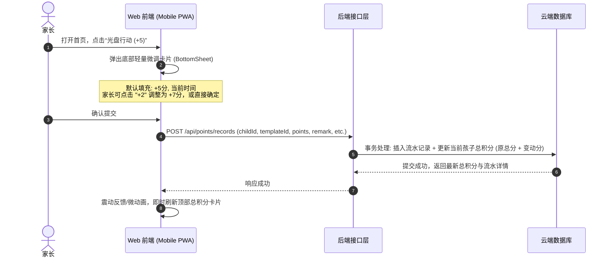
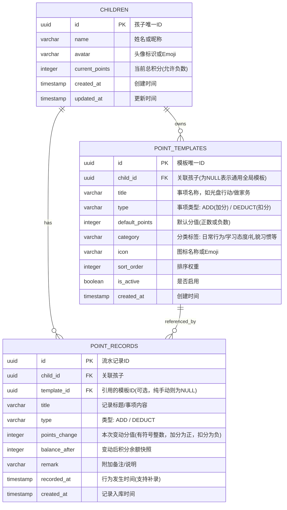
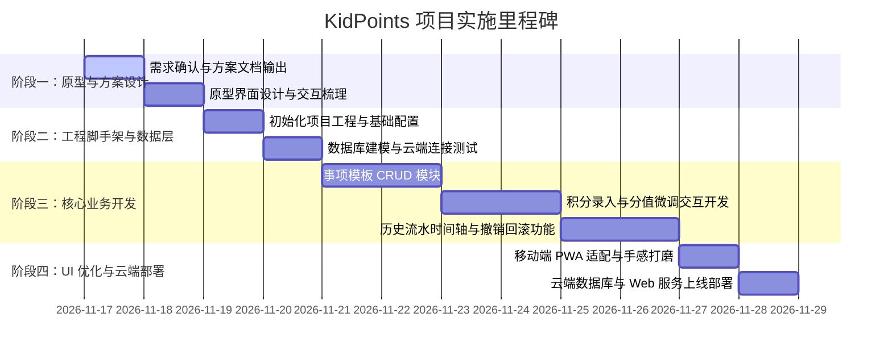

# 儿童积分管理系统 (KidPoints) 方案设计文档

## 一、 项目背景与需求概述

### 1.1 项目背景
为了帮助家长建立正向激励与习惯引导机制，需要一款轻量、便捷、支持随时通过手机/电脑浏览器记录的儿童积分 Web 应用。系统注重高频操作的极简体验，家长在日常管教中能够“一键记录、秒级完成”，并能随时查阅积分流水与变动趋势。

### 1.2 核心需求矩阵
| 需求维度 | 具体要求 | 系统设计对应方案 |
| :--- | :--- | :--- |
| **使用者定位** | 仅家长使用，无需儿童端 | 纯管理端架构，界面聚焦家长便捷录入与分析，支持访问鉴权（PIN码/密码）防止误触或外部访问 |
| **产品形态** | 浏览器访问的 Web 应用 | **Mobile-First 响应式 Web** + **PWA (Progressive Web App)**，支持“添加到手机桌面”获得原生级体验 |
| **事项与模板** | 自定义模板，反复使用；分值录入时可灵活调整 | 提供“预设事项库”，支持分类管理；点击事项弹出快速调整弹窗（支持微调分值与补充备注），也支持纯手动自由记一笔 |
| **分值规则** | 支持负数（可扣到负分），分值无下限 | 底层分值存储采用带符号整数（`INTEGER`），不设零值下限，界面对负分提供友好的警示与视觉区分 |
| **积分用途** | 仅用于记录与跟踪，不做商城兑换 | 系统不引入复杂的商品/兑换核销系统，保持极简；强化“历史流水明细”和“近期积分趋势走势” |
| **流水审计** | 完整的历史变动记录 | 每笔积分记录保存：变动前后分值快照、关联事项、发生时间、备注说明，支持过滤筛选与撤销/修正 |
| **存储方式** | 云端存储 | 数据托管于可靠的云端数据库，多设备实时同步，保证数据不丢失 |

---

## 二、 总体技术架构设计

### 2.1 架构设计目标
1. **轻量快捷**：家长日常使用要求“3秒内完成一次记分”。
2. **多端自适应**：以手机竖屏操作为主，兼顾平板和桌面大屏。
3. **零运维/低成本云端化**：优先选用现代 Serverless / 托管式云架构，免除复杂的云服务器运维。

### 2.2 技术选型推荐

综合开发效率、云端免运维部署和良好体验，设计提供**主流推荐方案**及**企业级备选方案**：

```
                ┌───────────────────────────────────────────┐
                │        家长浏览器端 (Mobile / Desktop)      │
                │        Next.js (React) / PWA + Tailwind   │
                └─────────────────────┬─────────────────────┘
                                      │ HTTPS / REST / RPC
                                      ▼
                ┌───────────────────────────────────────────┐
                │          BFF / 服务端 API 接口层           │
                │     Next.js Server Actions / Route API    │
                └─────────────────────┬─────────────────────┘
                                      │ Connection Pool / ORM
                                      ▼
                ┌───────────────────────────────────────────┐
                │           云端数据库 (Cloud DB)            │
                │     Supabase / Neon PostgreSQL / D1       │
                └───────────────────────────────────────────┘
```

#### 推荐方案（极简高效、全栈 TypeScript）：
- **前端技术栈**：Next.js 14/15 (App Router) + React 18/19 + Tailwind CSS + shadcn/ui + Lucide 图标库。
- **PWA 支持**：配置 Web App Manifest 与 Service Worker，支持 iOS Safari 和 Android Chrome “添加到主屏幕”，无浏览器地址栏干扰。
- **ORM 与数据访问**：Prisma 或 Drizzle ORM，类型安全、自动生成迁移。
- **云端存储与服务**：
  - **数据库**：PostgreSQL (可选用 Supabase / Neon / Railway 等免费或低成本托管云数据库)。
  - **部署平台**：Vercel / Zeabur / Cloudflare Pages，代码推送到 GitHub 即可自动构建上线。

#### 备选方案（Java 体系）：
- 若希望与现有 Java 基础设施整合，亦可采用：
  - 后端：Spring Boot 3 + Spring Data JPA / MyBatis-Plus + PostgreSQL / MySQL。
  - 前端：Vue 3 + Vite + Vant / Tailwind CSS 打包静态资源。

---

## 三、 功能模块与交互设计

```
KidPoints 系统功能全景
├── 1. 积分看板 (Dashboard)
│   ├── 孩子信息与当前积分卡片 (支持负分突出展示)
│   ├── 常用快捷记分区 (常用模板横滑/网格)
│   ├── 今日收支汇总 (今日 +X 分 / -Y 分)
│   └── 快速自由记一笔按钮
├── 2. 记积分交互 (Point Entry)
│   ├── 模板选择 (预设加分项 / 预设扣分项)
│   ├── 分值即时微调 (支持直接修改数字、快捷步进 +1/+5/-1/-5)
│   ├── 发生时间选择 (默认当前时间，可补记)
│   └── 备注说明 (可选录入详细原因)
├── 3. 事项模板管理 (Templates)
│   ├── 模板列表 (加分项、扣分项分类展示)
│   ├── 新增/编辑模板 (名称、预设分值、图标、分类、排序)
│   └── 禁用/启用/删除模板
├── 4. 历史流水与分析 (History & Logs)
│   ├── 时间轴明细列表 (按天分组、收支变动、变动后余额快照)
│   ├── 筛选过滤 (按类型：全部/加分/扣分，按日期范围)
│   ├── 误操作撤销/删除 (安全回滚积分)
│   └── 基础趋势图表 (近7天/近30天积分走势)
└── 5. 基础设置 (Settings)
    ├── 孩子信息管理 (姓名/昵称、头像/吉祥物选择)
    ├── 安全访问锁 (简易 PIN 码或口令防误触)
    └── 数据导出备份 (JSON/Excel 导出)
```

### 3.1 核心交互：3秒快捷记分流程


---

## 四、 数据库与核心数据模型设计

### 4.1 数据模型实体关系图 (E-R Diagram)



### 4.2 核心数据库表结构定义 (PostgreSQL DDL)

```sql
-- 1. 孩子信息表 (多孩子可扩展，单孩子默认预置一条)
CREATE TABLE children (
    id UUID PRIMARY KEY DEFAULT gen_random_uuid(),
    name VARCHAR(50) NOT NULL,                        -- 孩子姓名或小名
    avatar VARCHAR(255) DEFAULT 'default_avatar.png', -- 头像 URL 或内置 Emoji
    current_points INTEGER NOT NULL DEFAULT 0,        -- 当前总积分，支持负数 (无无符号约束)
    created_at TIMESTAMP WITH TIME ZONE DEFAULT CURRENT_TIMESTAMP,
    updated_at TIMESTAMP WITH TIME ZONE DEFAULT CURRENT_TIMESTAMP
);

-- 2. 积分事项模板表
CREATE TABLE point_templates (
    id UUID PRIMARY KEY DEFAULT gen_random_uuid(),
    child_id UUID REFERENCES children(id) ON DELETE CASCADE, -- 可关联特定孩子，NULL则为通用
    title VARCHAR(100) NOT NULL,                      -- 事项名称，如 "光盘行动", "整理房间", "打人顶嘴"
    type VARCHAR(20) NOT NULL CHECK (type IN ('ADD', 'DEDUCT')), -- 加分项 或 扣分项
    default_points INTEGER NOT NULL,                  -- 预设分值 (正数加分，负数扣分)
    category VARCHAR(50) DEFAULT '日常',              -- 事项分类
    icon VARCHAR(50) DEFAULT 'Star',                  -- 显示图标标识或 Emoji
    sort_order INTEGER DEFAULT 0,                     -- 排序优先级 (数值越小越靠前)
    is_active BOOLEAN DEFAULT TRUE,                   -- 是否启用显示在快捷区
    created_at TIMESTAMP WITH TIME ZONE DEFAULT CURRENT_TIMESTAMP
);

-- 3. 积分流水明细表 (只追加历史，保障审计完整性)
CREATE TABLE point_records (
    id UUID PRIMARY KEY DEFAULT gen_random_uuid(),
    child_id UUID NOT NULL REFERENCES children(id) ON DELETE CASCADE,
    template_id UUID REFERENCES point_templates(id) ON DELETE SET NULL, -- 允许模板删除后历史保留
    title VARCHAR(100) NOT NULL,                      -- 事项名称 (固化快照，防止模板改名影响历史)
    type VARCHAR(20) NOT NULL CHECK (type IN ('ADD', 'DEDUCT')),
    points_change INTEGER NOT NULL,                   -- 本次变动分值 (+5 或 -3)
    balance_after INTEGER NOT NULL,                   -- 变动后的历史余额快照
    remark TEXT,                                      -- 备注详情 (如: "虽然光盘了，但耗时较长")
    recorded_at TIMESTAMP WITH TIME ZONE NOT NULL DEFAULT CURRENT_TIMESTAMP, -- 行为实际发生时间
    created_at TIMESTAMP WITH TIME ZONE DEFAULT CURRENT_TIMESTAMP           -- 录入时间
);

-- 创建索引以优化高频查询
CREATE INDEX idx_point_records_child_recorded ON point_records(child_id, recorded_at DESC);
CREATE INDEX idx_point_templates_active ON point_templates(is_active, sort_order ASC);
```

### 4.3 负分支持与数据一致性机制
1. **分值规则与约束**：
   - `children.current_points` 字段使用标准 `INTEGER`，**不设置 `CHECK (current_points >= 0)`**，原生支持负数（如扣到 `-15` 分）。
   - 界面上，分值 `>= 0` 时采用鼓励色（如暖阳光橙/绿色），分值 `< 0` 时采用醒目的警示色（如蓝色/深灰色/红色），并配有正向引导的文案（例如：“离转正还差 5 分，继续加油哦！”）。
2. **并发与一致性保障**：
   - 采用数据库事务（Database Transaction）。记分时，先向 `point_records` 插入一条记录，并原子更新 `children.current_points = current_points + points_change`，并写入 `balance_after`。
   - 提供**记录撤销（Undo/Rollback）**能力：若家长误记，可在流水列表中撤销该笔记录，系统自动回滚对应积分并生成一条回滚流水。

---

## 五、 详细页面与 UI/UX 规划

### 5.1 页面 1：首页看板 (Dashboard)
- **顶部资产区**：
  - 孩子头像、昵称、**当前总积分（超大字体）**。
  - 今日动态统计：“今日 +15分 / -5分，净增 +10分”。
- **常用快捷事项卡片流 (Grid / Chips)**：
  - 划分为两大区域：**【加分习惯】** 与 **【扣分警告】**。
  - 每个卡片包含：图标、事项名称、预设分值气泡（如 `+5`、`-3`）。
  - 点击卡片：瞬间拉起微调面板，默认选中预设分值，可直接点击“确认记一笔”，也可使用 `[-5] [-1] [+1] [+5]` 快速微调，或手动输入数字。
- **自定义记一笔按钮 (FAB / 快捷入口)**：
  - 针对非模板的突发事件，快速输入名称和加减分值并保存。

### 5.2 页面 2：历史流水 (History Ledger)
- **按日期时间轴分组**：
  - 显示“今天”、“昨天”、“更早”，每条流水清晰呈现：发生时间、事项名称、分值变化（大标签 `+10` 或 `-5`）、结余快照（`变动后：42分`）、备注说明。
- **筛选器**：
  - 全部 / 仅看加分 / 仅看扣分。
- **单条记录详情与撤回**：
  - 点击单条记录可查看完整备注，支持在误操作时点击“撤回此记录”。

### 5.3 页面 3：事项库管理 (Template Management)
- **分类管理**：日常起居、学习习惯、行为习惯、违规扣分。
- **操作项**：
  - 点击已有模板进行修改（名称、默认分值、分类、图标）。
  - 新建自定义模板。
  - 支持拖拽或上下调整显示优先级（把最常用的排在前面）。

---

## 六、 RESTful API 规范设计

| 模块 | 方法 | 路径 | 描述 |
| :--- | :--- | :--- | :--- |
| **孩子模块** | `GET` | `/api/children` | 获取孩子列表及当前总积分 |
| | `GET` | `/api/children/:id` | 获取单个孩子详情与总分看板 |
| **模板模块** | `GET` | `/api/templates` | 获取启用的事项模板列表（按分类/权重排序） |
| | `POST` | `/api/templates` | 新建自定义事项模板 |
| | `PUT` | `/api/templates/:id` | 修改事项模板（名称、预设分值、图标等） |
| | `DELETE`| `/api/templates/:id` | 软删除或停用模板 |
| **记分流水** | `POST` | `/api/records` | **核心接口**：录入一笔积分流水（事务写入+总分变更） |
| | `GET` | `/api/records` | 分页查询历史流水（支持按类型/日期过滤） |
| | `DELETE`| `/api/records/:id` | 撤销某笔记录（回滚扣减或增加对应总分） |
| **统计模块** | `GET` | `/api/stats/summary` | 获取近 7 天 / 近 30 天积分趋势走势 |

---

## 七、 安全与云端部署方案

### 7.1 安全访问机制
- 考虑到应用仅供家长使用，且部署在公共 Web 网络上：
  - 采用**轻量访问保护（Parent PIN / Passcode）**：首次访问设定 4~6 位 PIN 码，浏览器端通过 Cookie/JWT 记住登录状态（可设置 30~90 天免登录）。
  - 防止外部未授权用户随意修改孩子积分。

### 7.2 云端部署方案推荐 (零服务器成本，开箱即用)
1. **方案 A（极简 Serverless 全托管，推荐首选）**：
   - **代码托管**：GitHub 仓库。
   - **前端与 API**：Vercel / Cloudflare Pages（全球加速、国内访问通畅、自动化 CI/CD）。
   - **云数据库**：Supabase (PostgreSQL 托管) 或 Neon / Supabase 中国区替代品。
2. **方案 B（国内常规云主机/Docker 容器部署）**：
   - 通过 Docker Compose 一键启动 `Next.js/Spring Boot + PostgreSQL`。
   - 配合 Nginx 反向代理与 SSL 证书，适合有自己的云服务器（腾讯云/阿里云/华为云）的场景。

---

## 八、 实施计划与里程碑



---

## 九、 方案结论与下一步行动

本设计方案严格遵循了“家长端专属”、“Mobile-First Web”、“支持负数”、“模板复用+分值微调”、“完整历史流水”和“云端可靠存储”等要求，整体方案具有轻快易用、高扩展性、零高昂维护成本的特点。

**下一步行动建议**：
1. 家长审阅方案文档，确认功能细节（如预设模板的初始事项建议、是否需要多孩子切换等）。
2. 确认技术路线（推荐全栈 TypeScript + Next.js + PostgreSQL，或 Spring Boot + 前端）。
3. 方案确认后，即可启动工程脚手架搭建与代码编写。
